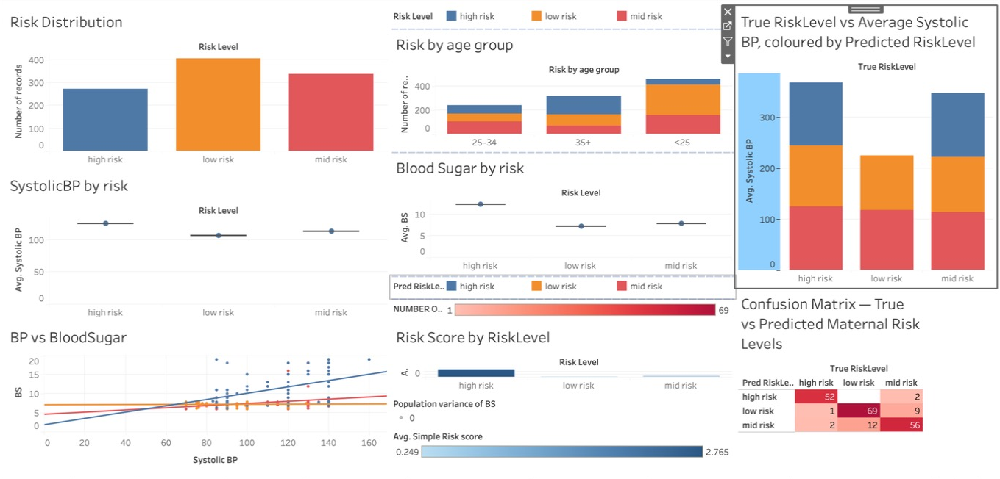
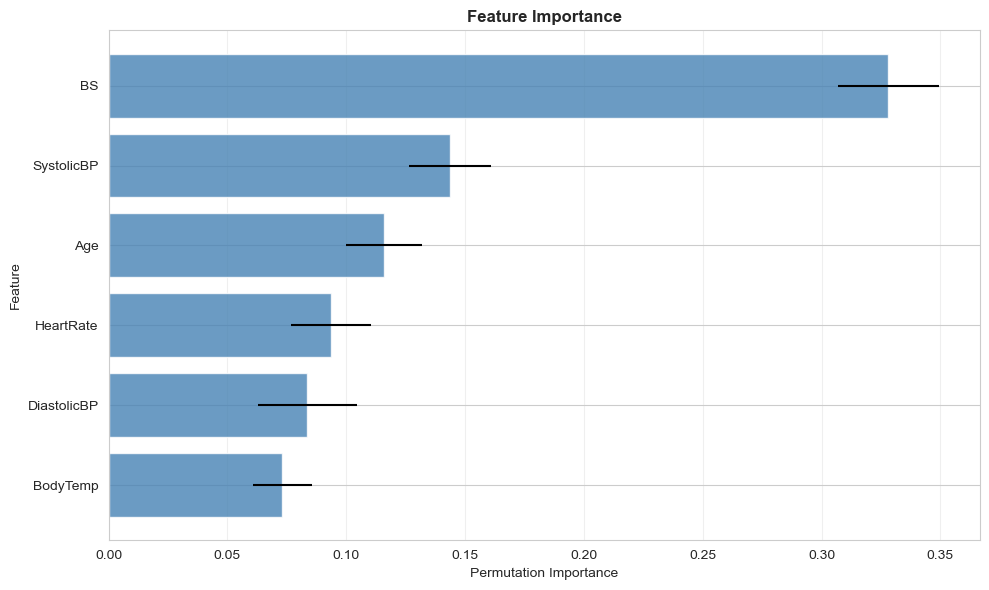
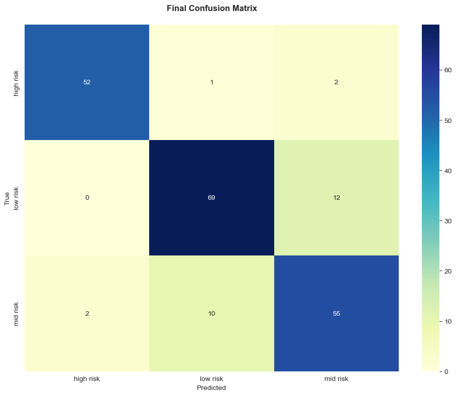
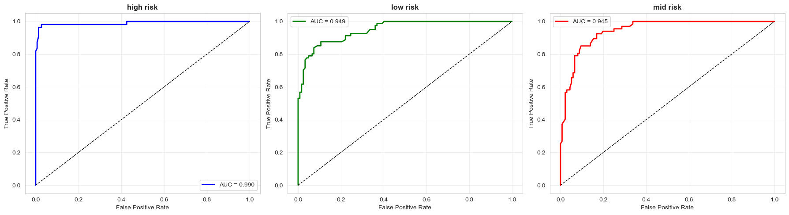

# Maternal Health Risk Classification

A machine learning study and Streamlit tool that classifies pregnant women into **low, mid or high risk** from six routinely collected vital signs. The work covers data quality checks, exploratory analysis, a Random Forest baseline, hyperparameter tuning, probability calibration and clinical-style error analysis.

Built for **COM725 Data Analytics & Visualisation** (MSc Data Science & AI, Solent University).

**[▶ View the interactive Tableau dashboard](https://public.tableau.com/app/profile/summar.ali5133/viz/MaternalHealthRiskDashboard_17921332867860/MaternalRiskDashboard)**

[](https://public.tableau.com/app/profile/summar.ali5133/viz/MaternalHealthRiskDashboard_17921332867860/MaternalRiskDashboard)

## Research question

Can routinely collected maternal vital signs (age, systolic and diastolic blood pressure, blood sugar, body temperature and heart rate) classify individuals into risk categories accurately enough to support triage?

## Data

[Maternal Health Risk dataset](https://archive.ics.uci.edu/dataset/863/maternal+health+risk) (UCI Machine Learning Repository, CC BY 4.0). It has 1,014 records collected via an IoT-based monitoring system in rural Bangladesh, split into 406 low, 336 mid and 272 high risk.

## Method

1. **Data quality assessment**: missing values, outliers, duplicates and class balance.
2. **EDA**: distributions, risk-stratified box plots, feature relationships and correlation.
3. **Baseline**: Random Forest with a stratified 80/20 train/test split.
4. **Tuning**: grid search over Random Forest hyperparameters.
5. **Calibration**: calibration curves so predicted probabilities can be read as risk.
6. **Evaluation**: confusion matrices, one-vs-rest ROC curves, learning curves, 5-fold cross-validation and feature importance.

## Results

| Model | Test accuracy | Macro F1 | High-risk F1 |
|---|---:|---:|---:|
| Baseline Random Forest | 0.872 | 0.879 | 0.95 |
| Tuned | 0.867 | 0.874 | 0.95 |
| Tuned + calibrated | 0.867 | 0.873 | 0.95 |

5-fold cross-validation accuracy: **0.830 ± 0.028**.



- **Blood sugar** and **systolic blood pressure** were the strongest predictors.
- High-risk cases were identified most reliably (precision 0.96, recall 0.95). Most errors were between low and mid risk rather than missed high-risk cases, which is the safer failure pattern clinically.

| | |
|---|---|
|  |  |

## Limitations

- **Identical rows across train and test.** 562 of the 1,014 records share exactly the same values as another record. These are distinct patients whose readings coincide, because the vitals are recorded coarsely (blood pressure in steps of 10, temperature almost always 98°F). Because identical feature vectors can fall in both the training and test sets, the 87% test accuracy may be slightly optimistic. The 5-fold cross-validation figure (83%) is the more conservative estimate.
- The data comes from one region (rural Bangladesh) and is small. External validation would be needed before any clinical use.
- A few values are physiologically implausible (e.g. a heart rate of 7 bpm) and were left in. Cleaning these would be a next step; the Streamlit app restricts inputs to plausible ranges.
- Six vital signs leave out important clinical context (history, gestational age, symptoms).
- This is an academic project and **not a clinical decision tool**.

## Project structure

```
notebooks/maternal_health_analysis.ipynb  # full analysis with outputs
app/app.py                                # Streamlit risk predictor
app/maternal_rf_model.pkl                 # trained, calibrated Random Forest
data/maternal_health_risk.csv             # UCI dataset
figures/                                  # analysis figures + dashboard screenshot
tableau/                                  # Tableau workbook and the CSVs it reads
```

## Running it

```bash
pip install -r app/requirements.txt
cd app
streamlit run app.py
```

To re-run the analysis, open `notebooks/maternal_health_analysis.ipynb` in Jupyter.

## Tech

Python · pandas · scikit-learn · matplotlib · seaborn · Streamlit · Tableau

## Author

**Summar Ali**, MSc Data Science & AI (Solent University). BACP-accredited psychotherapist with 15 years' NHS and community clinical experience, working on clinically grounded AI.
